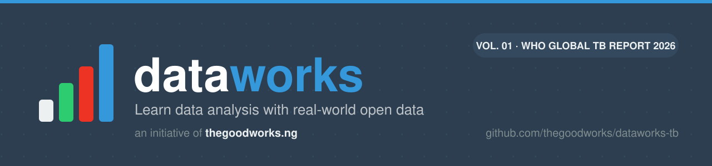

# dataworks · GTB Starter

**Learn data analysis with real-world open data.**

[](https://colab.research.google.com/github/thegoodworks/dataworks-tb/blob/main/TB_starter.ipynb)
[](https://colab.research.google.com/github/thegoodworks/dataworks-tb/blob/main/TB_starter_solutions.ipynb)
[](LICENSE)
[](https://github.com/GTB-TME/gtbreport2026)
[](https://github.com/thegoodworks/dataworks-tb/stargazers)

> ⭐ **If this helps you learn, [star this repo](https://github.com/thegoodworks/dataworks-tb) and [follow @thegoodworks](https://github.com/thegoodworks)** — it tells us to build more free, hands-on data lessons like this one.

---

## What is this?

A beginner-friendly Jupyter notebook that teaches the fundamentals of data analysis using the **WHO Global Tuberculosis Report 2026** database, freshly published, real, and openly available.

You'll `wget` the data straight from [WHO&#39;s own GitHub repo](https://github.com/GTB-TME/gtbreport2026), tour the **data dictionary**, and answer **10 questions about tuberculosis in Nigeria,** a country at the centre of a dramatic 2025–2026 TB funding shock. Along the way you'll learn filtering, ranking, shares, percentage change, `idxmax`/`idxmin`, missing-data handling, and how to catch a real data-entry error.

**No coding experience assumed.** Every question comes with:

- 🧭 a plain-English *think-it-through* plan (the logic before the code)
- 📖 a *column spotlight* quoting the official WHO data dictionary
- ✏️ a **fill-in-the-gap** code cell, the missing piece is a multiple-choice question (A–D)
- 💡 a visible hint, plus a sanity check so you know when you've got it
- ✅ a fully worked [solutions notebook](TB_starter_solutions.ipynb) when you're ready

## The 10 questions

| #  | Question                                                                                            | Skill you'll practise           |
| -- | --------------------------------------------------------------------------------------------------- | ------------------------------- |
| 1  | How many *distinct* values does Nigeria's incidence rate (`e_inc_100k`) take across 2000–2025? | filtering + `nunique`         |
| 2  | Ranked by cases notified in 2025 (`c_newinc`), where does Nigeria sit globally?                   | sorting + ranking               |
| 3  | What share of the WHO African Region's estimated incident cases in 2025 is Nigeria's?               | grouping + shares               |
| 4  | How did USAID funding received change from 2024 to 2025?                                            | percentage change               |
| 5  | What was the largest source of TB funding received in 2025?                                         | `idxmax` vs `max`           |
| 6  | How did the national TB budget change from 2025 to 2026?                                            | new-minus-old thinking          |
| 7  | Which budget line took the biggest absolute cut, 2025 → 2026?                                      | `idxmin` + dictionary reading |
| 8  | How did the number of molecular rapid tests performed change from 2024 to 2025?                     | choosing the right column       |
| 9  | In the latest reported treatment cohort, which unfavourable outcome was most common?                | handling missing data           |
| 10 | In which cohort year does "failed" exceed "died"?                                                  | data-quality detective work     |

…plus **5 bonus challenges** (treatment coverage, child preventive therapy, notification growth, age–sex patterns, and the budget-vs-reality funding gap).

## Quick start

**Option A: one click (recommended):** open the workbook in Google Colab with the badge above. Everything runs in your browser; the notebook downloads the data itself with `wget`.

**Option B: local:**

```bash
git clone https://github.com/thegoodworks/dataworks-gtb.git
cd dataworks-gtb
pip install pandas matplotlib jupyter
jupyter notebook GTB_starter.ipynb
```

Run the cells top to bottom. When you reach a ✏️ exercise, pick an option (A–D), replace the `___` in the code, and run. Stuck? Read the hint, `lookup()` the column in the dictionary, or peek at the [solutions](TB_starter_solutions.ipynb).

## Repo layout

```
GTB_starter.ipynb              ← the workbook (start here)
GTB_starter_solutions.ipynb    ← fully worked answers + explanations
assets/dataworks_banner.svg   ← branding
data/                         ← created at runtime by wget (not committed)
```

## Data & licence

- **Code & notebook text:** MIT © [thegoodworks.ng](https://www.thegoodworks.ng) (dataworks).
- **Data:** © World Health Organization. *WHO Global Tuberculosis Report 2026* database (`gtb_database`, snapshot 2026-08-25), accessed 17 November 2026 from [https://github.com/GTB-TME/gtbreport2026](https://github.com/GTB-TME/gtbreport2026). We gratefully acknowledge the **national TB programmes and other national authorities** that provided the underlying data.
- Data are used under the [WHO data policy](https://www.who.int/about/policies/publishing/data-policy) and its [terms and conditions](https://www.who.int/about/policies/publishing/data-policy/terms-and-conditions) (public-health purposes, attribution, no endorsement implied). We deliberately **do not re-host the CSVs.** The notebook fetches them from WHO's repository at runtime, so you always get the official files.
- This is an independent educational project by **dataworks**, an initiative of [thegoodworks.ng](https://www.thegoodworks.ng). It is **not affiliated with or endorsed by WHO**.

## About dataworks

[dataworks](https://www.thegoodworks.ng) is the data exploration and exposure arm of **theGOODworks -** a design, analysis & development studio. We believe the fastest way to learn data science is to ask real questions of real, open data.

- ⭐ **Star this repo** to bookmark the series and help others find it.
- 👥 **Follow [@thegoodworks](https://github.com/thegoodworks)** for the next volumes.
- 💬 Found a bug, or want to add your own question? Open an issue or a pull request. Contributions welcome.
- 🌐 More about us: [thegoodworks.ng](https://www.thegoodworks.ng)
